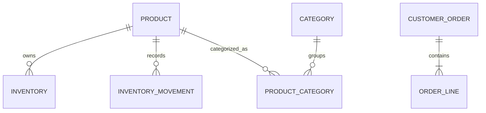

# Database model and ORM boundary

The catalog model contains products and categories; inventory, orders, and audit data extend the same learning application. Entity annotations and Flyway scripts express relational persistence. The repository does not contain a live SQL Server snapshot, so the target database must be inspected before using migrations against existing data.

JPA maps Java entities to relational rows, while EF Core maps CLR entities through a `DbContext`. Both have identity tracking and unit-of-work behavior, but Hibernate flushes pending changes independently from transaction commit. H2 tests validate selected repository and transaction behavior only.

**Pitfalls:** entity relationships can trigger lazy-load failures or N+1 queries; SQL Server-specific locking/types/migrations are not proven by H2; never enable Hibernate schema update against an existing database.

**Lab:** trace `ProductEntity` fields to the SQL Server migration and compare with an EF Core entity/configuration pair. Source: [ProductEntity](../../src/main/java/com/example/catalog/product/infrastructure/persistence/entity/ProductEntity.java), [Flyway migrations](../../src/main/resources/db/migration).

