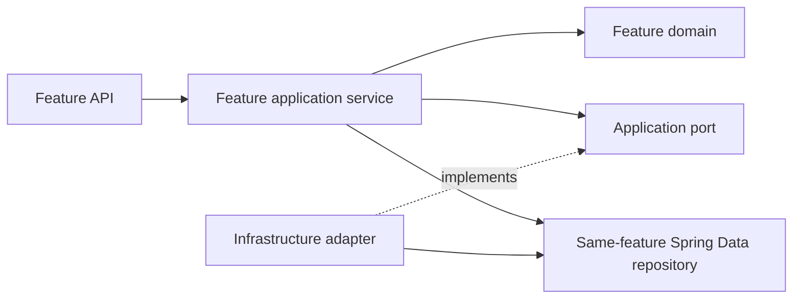

# Dependency flow

Controllers depend on application use cases and transport records. Application services own use-case rules and transaction boundaries. Cross-feature calls target application contracts and pass IDs, primitives, and application read models; they do not reach into another feature's entity or repository. Domain code does not depend on Spring, HTTP, JPA, application, or infrastructure. Infrastructure contains JPA mappings, Spring Data queries, adapters, and framework configuration.

Cross-feature production paths today are Category → Product catalog lookup; Inventory → Product lookup and Audit recording; Ordering → Product lookup, Inventory operations, and Audit recording. The package-cycle ArchUnit rule checks that these links stay one-way.

The application layer still depends on its own feature's Spring Data repository/entity types. This explicit learning tradeoff avoids duplicated models and mappings in the current small starter. It is documented rather than presented as a fully persistence-independent design. See [dependency rules](dependency-rules.md) and [module ownership](module-boundaries.md).

Responsibility subpackages and the current request flow are documented in [project structure](project-structure.md) and [ADR 0005](../adr/0005-responsibility-packages.md). Application code must not depend on HTTP DTOs; input/result/port values remain framework-free.
