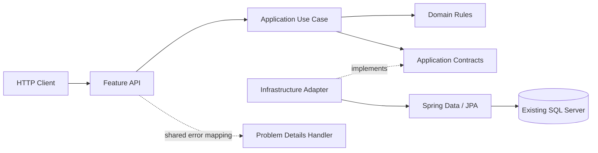

# Layer responsibilities

The intended source dependency points inward: API calls application; application owns the use case and may depend on domain types and narrow ports; infrastructure implements ports and contains framework/database details. Spring Boot starts from `com.example.catalog.CatalogApplication`, which remains above every feature package so component and JPA scanning continue to include moved types.

## API

Controllers bind and validate request DTOs, call an application use case, and select HTTP responses. Request and response records remain separate from entities. Application mappers convert entities to application results. API mappers convert requests to inputs and results to HTTP responses; transport DTOs do not import JPA types.

## Application

Application services coordinate transactions and business workflows. Cross-feature contracts are introduced where a real boundary exists: Product exposes catalog lookup, Inventory exposes reservation/release operations, and Audit exposes recording. Application owns those contracts; adapters are selected by Spring dependency injection.

For this learning starter, application services continue to use same-feature Spring Data interfaces and JPA entities. A separate persistence port and domain model are justified when persistence replacement, domain isolation, or independent module testing has enough value to cover the extra mapping code.

## Domain

Domain contains business types and exceptions. It has no Spring MVC, Spring Data, Jakarta Persistence, database, or other-layer dependency. Keep transport validation in API request records and persistence annotations on infrastructure entities.

## Infrastructure

Infrastructure contains JPA entities, Spring Data repositories, adapters, and framework configuration. It should not become a second home for use-case rules. Category owns the product-category join mapping; Product's category filter uses an explicit table query so it does not import Category's persistence entity.

## .NET comparison

This resembles feature slices around ASP.NET Core endpoints, application services, domain types, and EF Core persistence, but Java package boundaries do not create assemblies. ArchUnit tests enforce selected dependency rules within the single Maven application.

Responsibility subpackages and the current request flow are documented in [project structure](project-structure.md) and [ADR 0005](../adr/0005-responsibility-packages.md). Application code must not depend on HTTP DTOs; input/result/port values remain framework-free.
