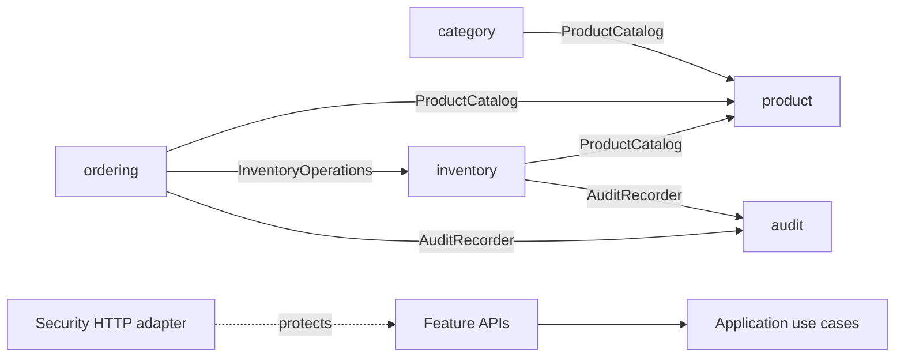

# Module boundaries

## Ownership

- **Product** owns SKU, product data, catalog lookup, and Product persistence.
- **Category** owns category rules and the product-category association. `ProductCategoryEntity`, `ProductCategoryId`, and `ProductCategoryRepository` remain in Category because Category currently owns assignment and deletion behavior. Product filtering refers to the association table with a native query rather than importing the Category JPA entity.
- **Inventory** owns on-hand/reserved quantities, adjustment and reservation rules, and movement history. Ordering uses `InventoryOperations` and does not edit inventory tables.
- **Ordering** owns order identity, line snapshots, lifecycle, and idempotency. Order lines preserve SKU/name/price as accepted at order creation.
- **Audit** owns audit records and exposes `AuditRecorder`; consumers do not access the audit repository or entity.
- **Security** is a cross-cutting HTTP adapter under `security.infrastructure`; identity management remains outside this learning project.
- **Shared API** owns the Problem Details error shape and maps feature exceptions to HTTP responses.

No feature should import another feature's JPA entity or Spring Data repository. Integration tests may use multiple feature repositories to build realistic transaction fixtures; production code ownership remains explicit.

See [dependency rules](dependency-rules.md) and the [pre-refactor migration map](refactor-migration-map.md).

Responsibility subpackages and the current request flow are documented in [project structure](project-structure.md) and [ADR 0005](../adr/0005-responsibility-packages.md). Application code must not depend on HTTP DTOs; input/result/port values remain framework-free.
