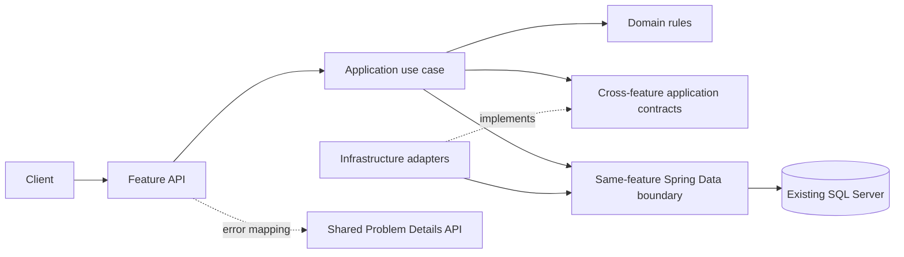

# Application architecture overview

This is one Spring Boot modular monolith organized by feature and responsibility. `CatalogApplication` remains at `com.example.catalog`, so Boot's default component, entity, and repository scanning includes moved feature packages.

Cross-feature dependencies point to application contracts: Category and Inventory use Product catalog lookup; Ordering uses Product lookup, Inventory operations, and Audit recording. ProductCategory persistence remains owned by Category. The application layer currently uses same-feature Spring Data/JPA types as a pragmatic boundary; separate domain models and persistence ports are deferred until they provide concrete value.

The normal request path resembles ASP.NET Core controller → application service → EF Core context. Spring Data repositories, JPA flush behavior, and transaction proxies have different details. See [request flow](../spring-mvc/request-lifecycle.md), [project structure](project-structure.md), [layer responsibilities](layered-architecture.md), and [dependency rules](dependency-rules.md).

Development targets existing SQL Server through environment configuration. Default tests use H2 and do not prove SQL Server compatibility.

**Lab:** trace `POST /api/v1/products` through validation, application use case, persistence, and response mapping. Source: [ProductController](../../src/main/java/com/example/catalog/product/api/controller/ProductController.java), [ProductService](../../src/main/java/com/example/catalog/product/application/service/ProductService.java).

Responsibility subpackages and the current request flow are documented in [project structure](project-structure.md) and [ADR 0005](../adr/0005-responsibility-packages.md). Application code must not depend on HTTP DTOs; input/result/port values remain framework-free.
