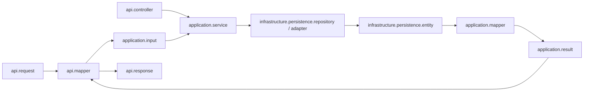

# Project structure

The single Maven application keeps business ownership at the first package level. Each populated layer is then divided by responsibility. `CatalogApplication` stays at `com.example.catalog` so component, entity and repository scanning include every feature.

```text
com.example.catalog
├── CatalogApplication
├── api/error/ApiExceptionHandler
├── product/                         # category, inventory and ordering follow the same roles
│   ├── api/
│   │   ├── controller/              # HTTP routes, status codes, validation entry points
│   │   ├── request/                 # HTTP input records with Jakarta validation
│   │   ├── response/                # HTTP output records
│   │   └── mapper/                  # request -> input, result -> response
│   ├── application/
│   │   ├── service/                 # use cases and public transaction boundaries
│   │   ├── input/                 # framework-free use-case inputs
│   │   ├── result/                  # framework-free outputs and catalog snapshots
│   │   ├── port/                    # cross-feature interfaces where needed
│   │   └── mapper/                  # own-feature entities -> application results
│   ├── domain/exception/           # business failures
│   └── infrastructure/persistence/
│       ├── entity/                  # JPA mappings and embedded IDs
│       ├── repository/              # Spring Data interfaces and queries
│       └── adapter/                 # database implementations and native SQL
├── category/                        # owns product-category association
├── inventory/                       # owns stock, movement history and reservations
├── ordering/                        # owns orders; also has domain/model/OrderStatus
├── audit/                           # application/port and persistence packages only
└── security/infrastructure/
    ├── config/                      # SecurityConfig
    └── filter/                      # CorrelationIdFilter
```

Only create a role package when it has a consumer. Category and Ordering do not need a persistence adapter package yet; Inventory receives primitive inputs and does not need input records. Audit has no HTTP layer.

## Request flow



Application services never import HTTP DTOs or EntityManager. Native inventory updates and persistence-context synchronization live in `InventoryStockWriter`; the service retains locking decisions, business checks, transaction ownership, movement recording and audit coordination. Mapping code does not issue queries.

This is a pragmatic feature/layer architecture. Application services and result mappers still depend on their own feature's JPA entities and Spring Data repositories. It is not fully persistence-independent Clean Architecture; introducing duplicate domain models and persistence ports for every class is outside this refactor.

## Enforcement and extension

`ModuleBoundaryTest` checks role packages, API/infrastructure isolation, application/HTTP isolation, framework-free input/result/port types, domain independence, feature cycles and foreign persistence imports. Tests mirror the source packages.

When adding a feature, add only the roles it needs, preserve constructor injection, keep transactions on public service methods, and expose a narrow application port if another feature needs access. Keep HTTP request validation and response schemas at the API boundary.

See [ADR 0005](../adr/0005-responsibility-packages.md), [dependency rules](dependency-rules.md) and [module ownership](module-boundaries.md).
